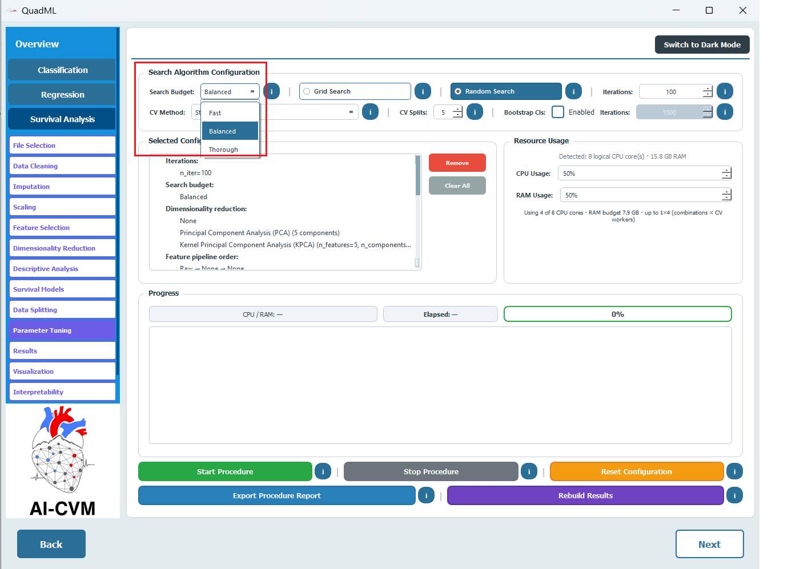

# Survival Analysis — Parameter Tuning

**Where**: Survival Analysis → **Parameter Tuning**

On **Parameter Tuning** you set the search budget, algorithm, and cross-validation, then start the combinatorial run over the Descriptive models and/or Imputation × Scaling × Feature Selection × Dimensionality Reduction × Survival Model choices from the earlier steps. There is **no** Imbalance Handling panel (Classification-only).

---

## What to click

### Search controls

1. **Search Budget:** Fast / Balanced / Thorough — scales Random Search iterations (typically 10 / 100 / 1000) and suggested CV folds. For Grid Search, grids also lean by cohort size (small / medium / large `n_train`). It does **not** remove methods or models you already checked.
2. **Search algorithm:** **Grid Search** or **Random Search** (Random Search has **Iterations** / `n_iter`).
3. **Cross-validation** method and number of splits (used inside Train). Survival offers **Shuffle Split** and **Stratified K-Fold** (event-aware; useful when events are scarce). Survival does **not** offer Leave-One-Out.

For a first run, **Fast** or **Balanced** is enough.

### Bootstrap CIs and resources

4. Optional **Bootstrap CIs** — 95% percentile intervals for Harrell / Uno C-index, td-AUC, IBS, Mean Calibration / Slope / ICI. Enable here and re-run; QuadML resamples evaluation subjects and reuses stored predictions (does not refit models).
5. **Resource Usage:** CPU % and RAM % (default 50 / 50).

### Configuration tree and run

6. Review the **selected configuration** tree (descriptive models and/or each imputer × scaler × FS × DR × survival model).
7. **Start Procedure** — reads data, cleans, searches, writes **`Final_Results.csv`**.
8. **Stop Procedure** — cancels; partial combo results may remain.
9. If the procedure stops or crashes mid-run, click **Rebuild Results** to rebuild `Final_Results.csv` from finished `combo_results/*.json` files.
10. Other actions as labeled: **Reset Configuration**, **Export Procedure Report**, **Rebuild Results**.

Click **i** next to Start Procedure, Adaptive Search / Search Budget, CV, and bootstrap for the in-app wording.

### Evaluation horizons reminder

Horizons for td-AUC / IBS / calibration are set on **File Selection** (Auto / Long-term / Short-term / Custom). Prefer **Auto from follow-up** when follow-up is shorter than fixed clinical year marks.

---

## What is written to disk

In the dated run folder under your **Output Directory**:

- `Final_Results.csv` — one row per pipeline combination
- `combo_results/` JSON (can rebuild the CSV if a run is interrupted)
- Fitted pipelines (`.pkl`), prepared data, plot caches under model folders
- Procedure report (if exported)

---

## Common mistakes

- Starting with every FS method and every ML model on a large cohort — combination count is a product
- Ranking later by C-index alone when you need absolute risk
- Ignoring RSF / EST large-`.pkl` size during a Thorough + large grid search
- Changing File Selection columns or horizons after a long configure pass without checking the tree
