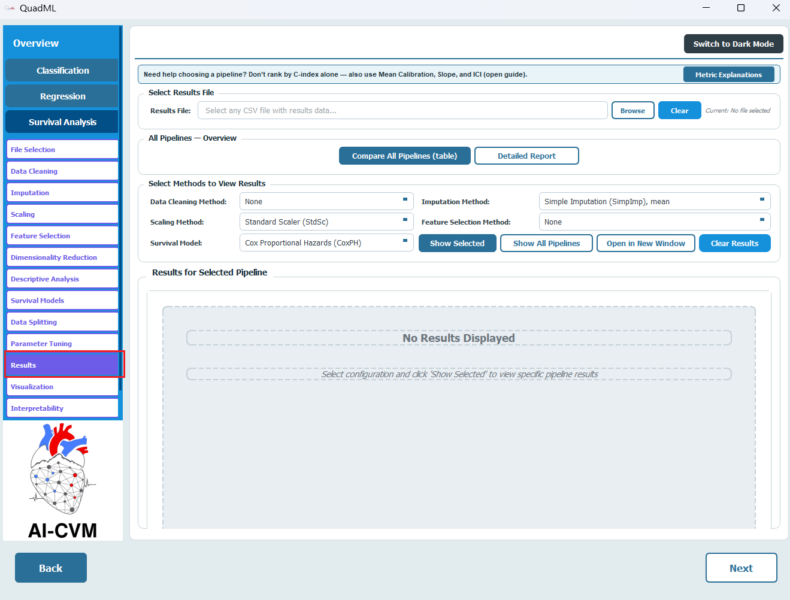
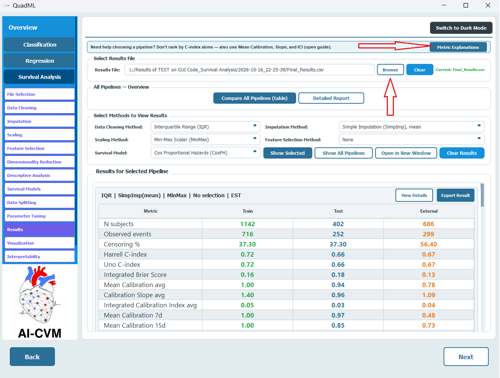

# Survival Analysis — Metrics

Shows discrimination and calibration scores for every searched pipeline after **Start Procedure** (or **Rebuild Results**). Load `Final_Results.csv` from the output run folder, then filter by cleaning, imputation, scaling, feature selection, dimensionality reduction, and survival model to open Train / Test (or External) cards. You see ranking-oriented discrimination metrics (**C-index**, **td-AUC**, Integrated AUC when reported) and absolute-risk calibration / error metrics (**IBS**, **Mean Calibration**, **Calibration Slope**, **ICI**). Descriptive rows (Kaplan–Meier / Nelson–Aalen) appear with preprocess as `N/A` and may include cohort-comparison p-values for Train vs Test balance. Prefer held-out **Test** or **External** scores when choosing a model; when absolute risk matters, check calibration first, then C-index / td-AUC among well-calibrated pipelines—do not rank by C-index alone. Open **Metric Explanations** in the app for full definitions.

--8<-- "_snippets/results-usage.md"

Browse or confirm `Final_Results.csv` for the output run folder, then filter pipelines and open Train / Test / External metrics:

**Compare All Pipelines (table)** ranks configurations by CV Harrell C-index (Test metrics are for reference):

**Detailed Report** opens the full CSV-style metric view (including descriptive KM rows when present):

## Discrimination (higher is better)

| Metric | What it means | Better |
|--------|---------------|--------|
| C-index | Concordance of predicted risk with observed order | Higher |
| td-AUC | Time-dependent AUC at evaluation horizons | Higher |
| Integrated AUC | Summary of td-AUC over time (when reported) | Higher |

## Calibration / error (context-dependent)

| Metric | What it means | Better |
|--------|---------------|--------|
| IBS | Integrated Brier score of predicted survival | Lower |
| Mean Calibration | Average predicted vs observed event rate | Near **1** |
| Calibration Slope | Slope of predicted vs observed risk | Near **1** |
| ICI | Integrated calibration index | Lower |

## Cohort / descriptive rows

| Metric / flag | What it means |
|---------------|----------------|
| N/A preprocess | KM / Nelson–Aalen skip imputation, scaling, FS, DR |
| Cohort comparison p-values | Train vs Test balance checks (when shown) |

When absolute risk matters: prefer calibration (**Mean Cal**, **Slope**, **ICI**) first, then Test C-index / td-AUC among well-calibrated rows. Do not rank by C-index alone. Open **Metric Explanations** in the app for full definitions.

## Common mistakes

- Comparing runs from different Output Directory dated folders without noting File Selection changes
- Expecting Bootstrap CI columns when Bootstrap was off for that run
- Opening a `Final_Results.csv` from a different mode
- Picking by Train metrics while held-out scores are poor
