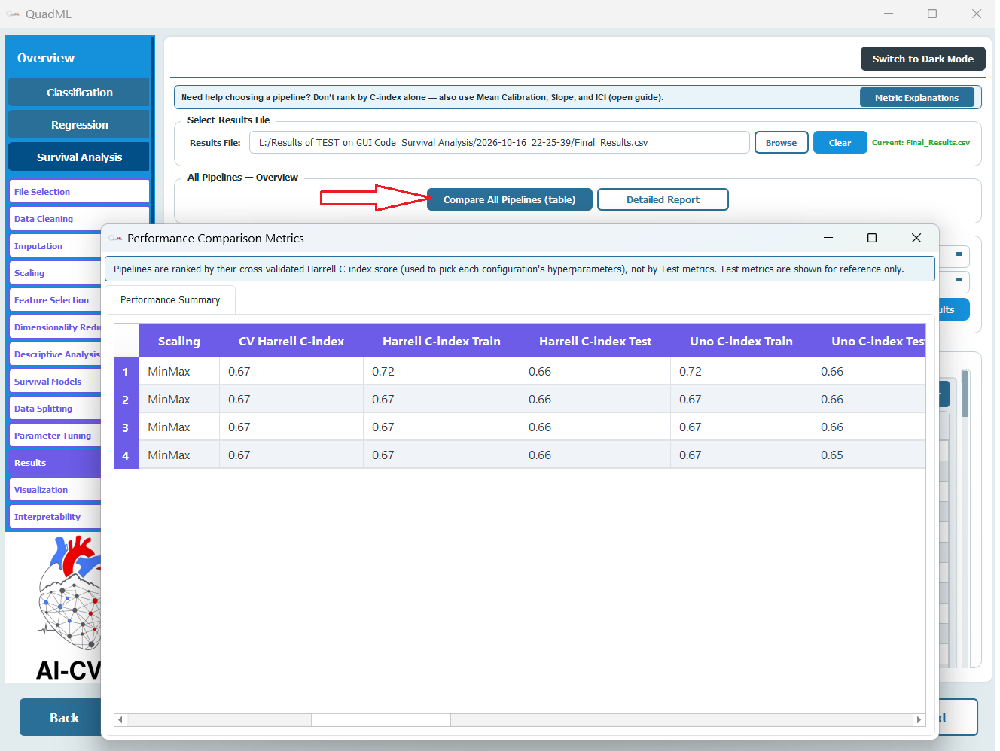
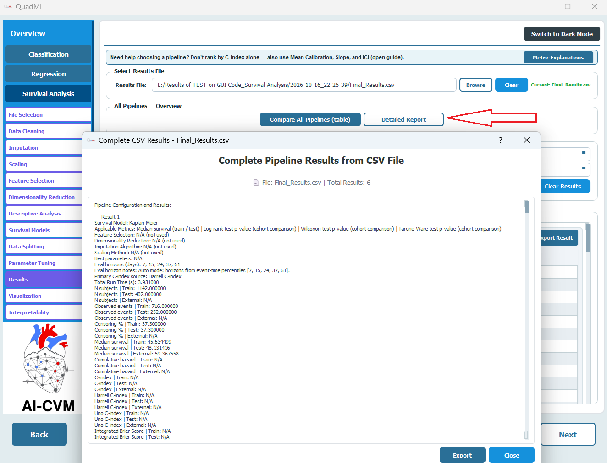
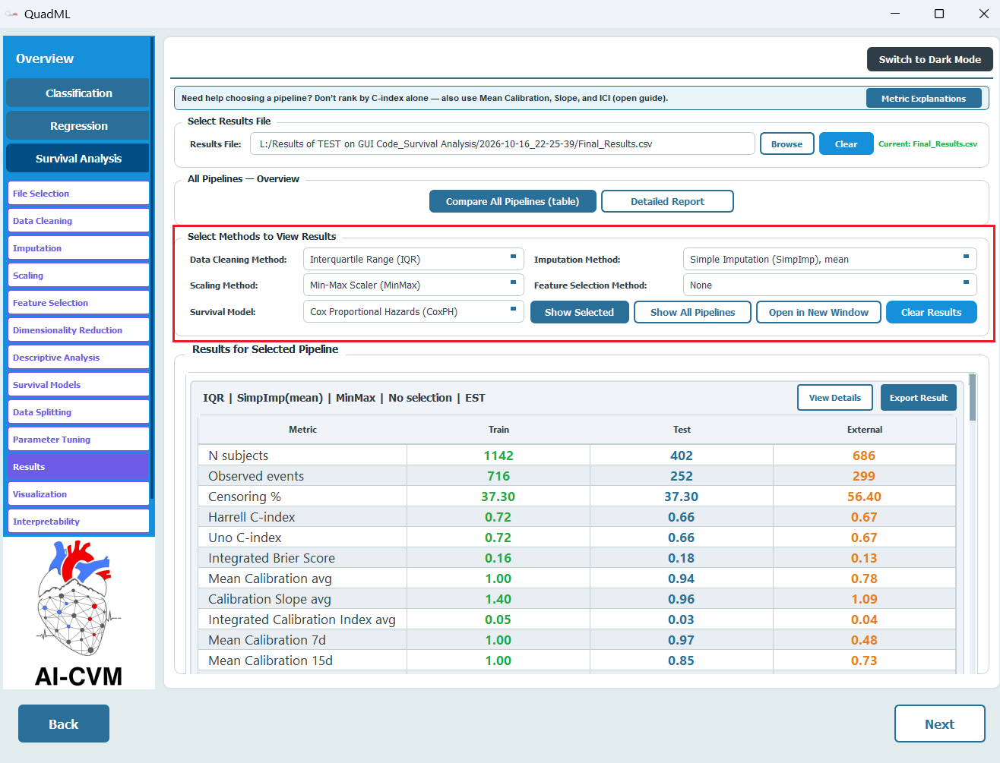
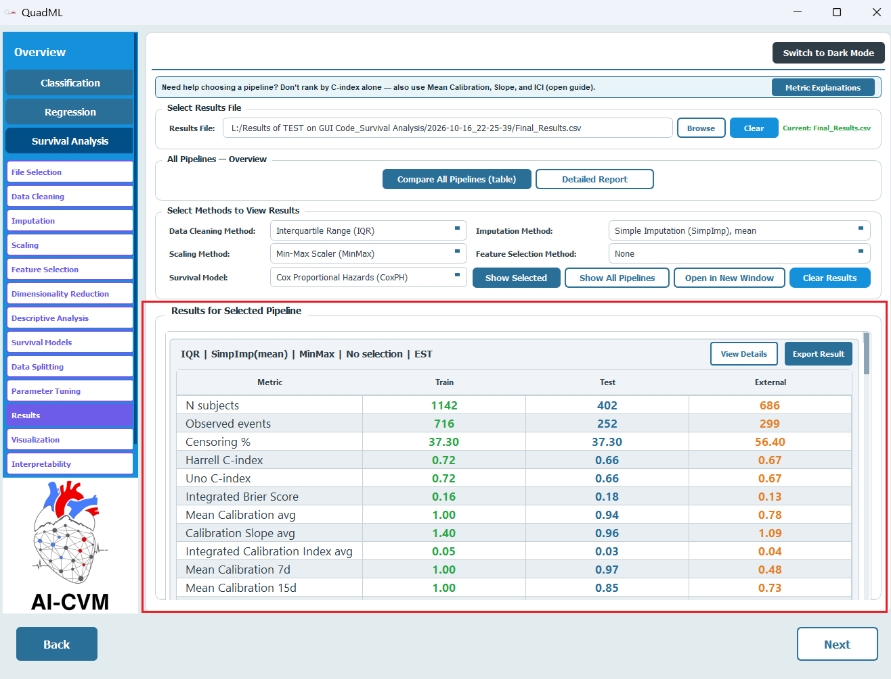

# Survival Analysis — Results

**Where**: Survival Analysis → **Results**

After **Start Procedure** finishes, **Results** loads `Final_Results.csv` from the dated run folder and shows each searched pipeline combination with its Train and Test metrics (or External metrics when Train on all data is on), so you can compare, filter, and open detailed reports. You can also **Browse** an older run folder that already contains `Final_Results.csv` (or combo JSON) to reload and inspect previous results without starting a new search.

---

## What to click

1. Confirm the results file. QuadML looks for **`Final_Results.csv`** in the run folder. You can **Browse** another folder that contains that CSV or combo JSON.
2. Read the pipeline cards: **Train** on the left, **Test** on the right (or **External** when Train-on-all-data is on). Some columns appear once per pipeline (model-fit stats, cohort comparison).
3. Click **Metric Explanations** on the top bar for the full, in-app metric text.
4. Use overview actions as labeled, for example:
   - **Compare All Pipelines (table)**
   - **Detailed Report**
   - **Show Selected** / **Show All Pipelines** / **Open in New Window** / **Clear Results**
5. Filter by cleaning, imputation, scaling, feature selection, DR, and model as shown on the page.

---

## How to choose a pipeline (do not rank by C-index alone)

When absolute risk or survival probabilities matter:

1. Prefer **Mean Calibration ≈ 1**, **Calibration Slope ≈ 1**, and **lower ICI**.
2. Among those, prefer higher **Test** (or **External**) Harrell / Uno C-index (and td-AUC if horizon-specific).
3. Use **Integrated Brier Score** (lower) as an overall probabilistic check.

When only ranking patients matters, Test C-index can be primary — still check Train/Test gaps.

### Discrimination (covariate models)

**Higher better:** Harrell C-index, Uno C-index, td-AUC at horizons.

**Lower better:** Integrated Brier Score (IBS).

### Calibration

- **Mean Calibration ≈ 1** (KM incidence / mean predicted risk)
- **Calibration Slope ≈ 1**
- **ICI ≈ 0** (lower better)

### Descriptive models

- **Kaplan-Meier:** median survival
- **Nelson-Aalen:** cumulative hazard

### Other columns

- **Cox:** AIC/BIC, Schoenfeld global p-value, partial likelihood tests
- **AFT:** AIC/BIC
- **RSF:** OOB C-index
- **Cohort comparison:** Log-rank / Wilcoxon / Tarone-Ware (Train vs Test survival curves)

Optional **Bootstrap CIs** appear on scalar metrics when enabled on Parameter Tuning.

For full definitions, open **Metric Explanations** in the app.

---

## What is written to disk

You are reading files already written by the search (`Final_Results.csv`, combo JSON, pipelines). Export extra CSV or report files from the Results buttons if you need a copy elsewhere.

---

## Common mistakes

- Choosing the single highest Test C-index with poor Mean Cal / Slope / ICI
- Treating Train C-index as generalization
- Expecting C-index on KM / Nelson–Aalen the same way as Cox
- Opening a `Final_Results.csv` from a different mode or an older run by mistake
