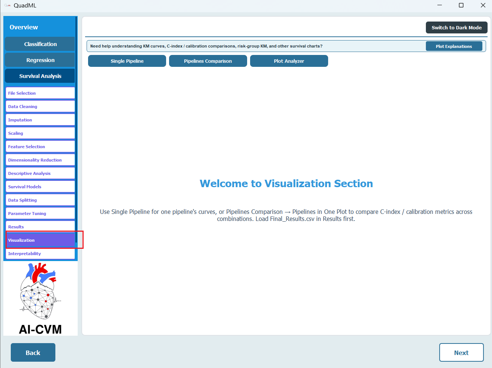

# Survival Analysis — Visualization

**Where**: Survival Analysis → **Visualization**

Charts for descriptive curves, discrimination, and calibration. Load `Final_Results.csv` in **Results** first.

--8<-- "_snippets/visualization-usage.md"

## Descriptive models

| Plot | What it shows |
|------|----------------|
| Kaplan-Meier | Cohort survival \(S(t)\) |
| Median Survival | Median survival when defined |
| Nelson-Aalen | Cumulative hazard \(H(t)\) |

## Discrimination / risk

| Plot | What it shows |
|------|----------------|
| Risk Group KM | Median Train risk cut applied to Test/External |
| Risk Score Distribution | Predicted risk scores |
| Risk vs Duration | Risk against follow-up time |
| td-AUC vs Time | Discrimination across horizons |
| C-index / metric bars | Compare pipelines |

## Calibration / utility

| Plot | What it shows |
|------|----------------|
| Calibration Plot | Predicted vs observed risk |
| Mean Cal / Slope / ICI bars | Across pipelines |
| Calibration vs Time | Calibration over horizons |
| Decision Curve | Net benefit at a horizon (hidden for SSVM) |

## Other

| Plot | What it shows |
|------|----------------|
| Censoring Timeline | Follow-up / censor pattern |
| AFT QQ / P–P | AFT fit checks (AFT only) |

Use **Plot Explanations** / **Analyze** for in-app help. KM / Nelson–Aalen often need **Single Pipeline** views.

## Common mistakes

- Opening Visualization before any successful combination finished
- Mixing plots from an older dated folder after starting a new run
- Reading Train-only plots as trustworthy absolute performance
