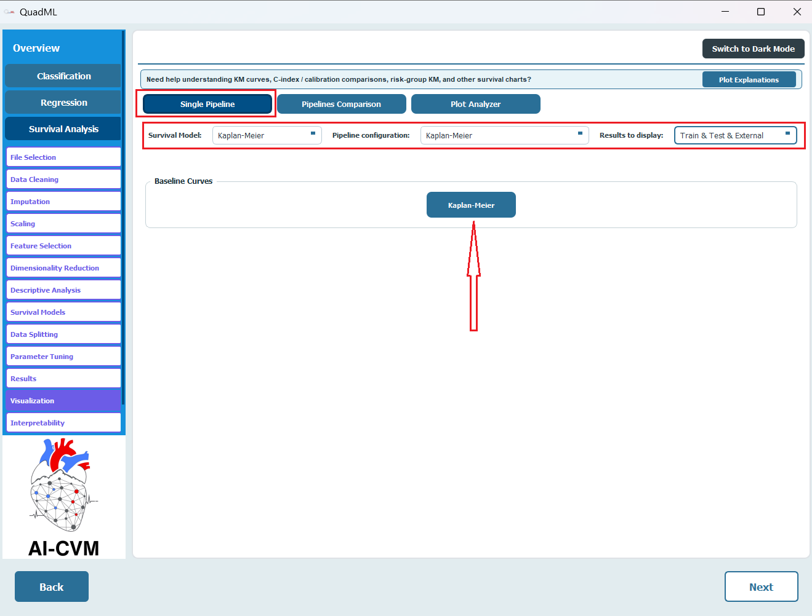
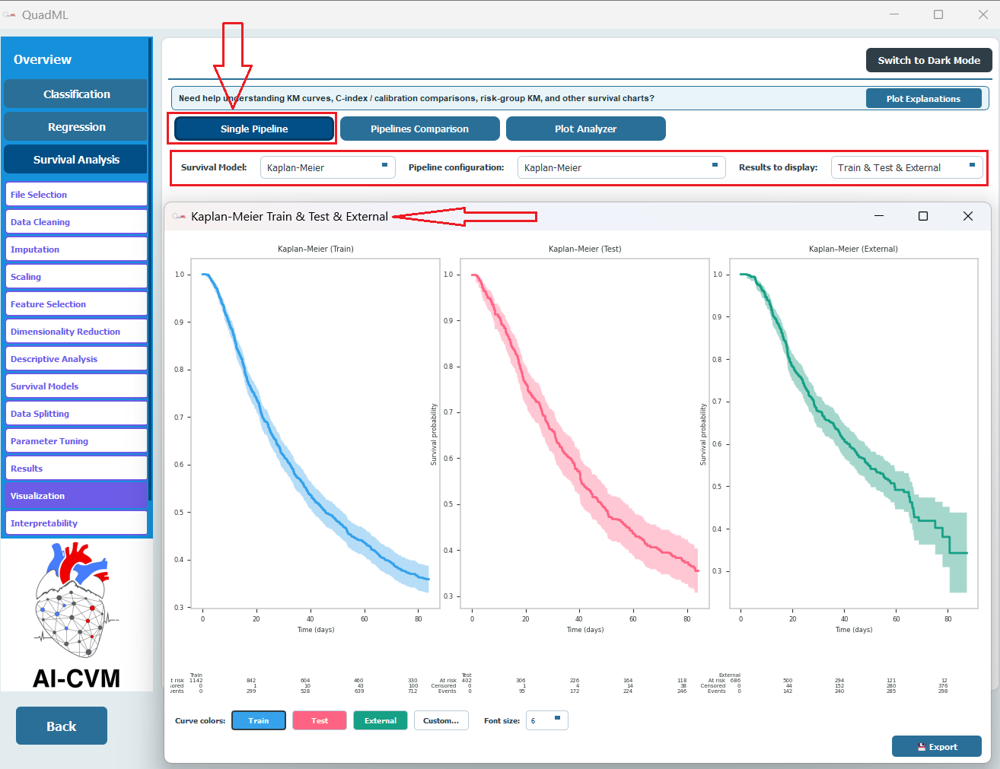
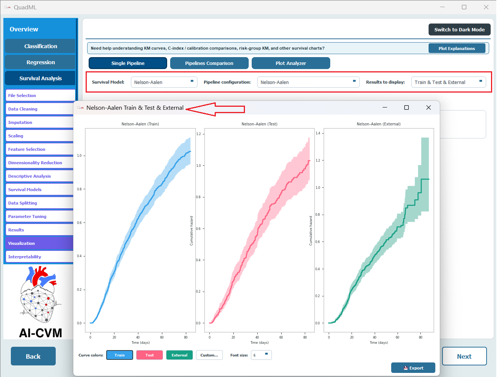
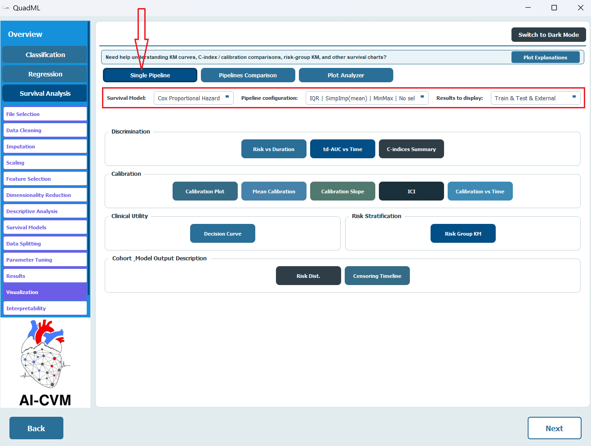
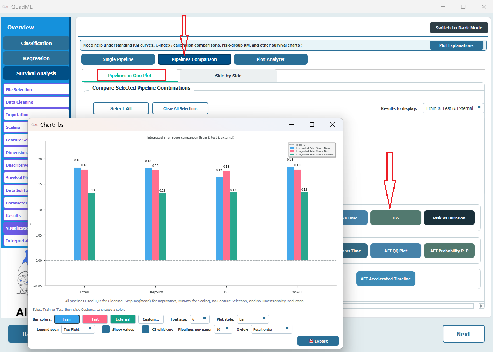

# Survival Analysis — Visualization

**Where**: Survival Analysis → **Visualization**

**Visualization** turns the finished search into plots. Load **`Final_Results.csv`** in **Results** first; charts read metrics and saved plot data from that dated run folder. Prefer **Test** or **External** when judging generalization (Train plots alone are not enough).

---

## What to click

1. Choose which results to display (**Train**, **Test**, **External**, or combined splits).
2. Work in **Single Pipeline** or **Pipelines Comparison** (**Pipelines in One Plot** / **Side by Side**).
3. Click **Plot Explanations** on the top bar for the full in-app plot text.
4. Use **Analyze** (Plot Analyzer) on a figure for a structured reading of the current plot.
5. Where shown, use the Data combo to switch split when supported.

---

## Plot groups (what you will find)

### Descriptive models

| Chart | What it shows |
|-------|----------------|
| Kaplan-Meier | \(S(t)\) for selected split(s) |
| Median Survival | Median survival when defined |
| Nelson-Aalen | Cumulative hazard \(H(t)\) |

### Covariate models — discrimination / risk

| Chart | What it shows |
|-------|----------------|
| Risk Group KM | Median Train risk cut applied to Test/External |
| Risk Score Distribution | \(r(T)=1−S(T)\) |
| Risk vs Duration | Risk against follow-up time |
| Discrimination metrics / C-index bars | Compare pipelines |
| td-AUC vs Time | Discrimination across horizons |

### Covariate models — calibration / utility

| Chart | What it shows |
|-------|----------------|
| Calibration Plot | KM quantile points + Cox+RCS curve |
| Mean Calibration / Slope / ICI bars | Across pipelines |
| Calibration vs Time | Calibration over horizons |
| Decision Curve (stdca) | Clinical treat threshold at a horizon — hidden for SSVM |

### Other

| Chart | What it shows |
|-------|----------------|
| Censoring Timeline | Follow-up / censor pattern |
| AFT QQ / P–P / Accelerated Timeline | AFT fit checks (AFT only) |
| All Saved Plots | Browser of plots written during search |

---

## Bootstrap CI whiskers

When Bootstrap CIs were enabled on Parameter Tuning, C-index / td-AUC / Calibration vs Time charts can show interval whiskers. KM curves and risk histograms stay point-only unless otherwise noted.

---

## Quick guide — which plot to open

| Goal | Start with |
|------|------------|
| Cohort survival | KM / Nelson-Aalen |
| Risk separation | Risk Group KM |
| Absolute risk quality | Calibration Plot; Mean Cal / Slope / ICI |
| Discrimination vs time | td-AUC vs Time |
| Rank many pipelines | Mean Cal / Slope / ICI, then C-index |
| Clinical treat threshold | Decision Curve |
| AFT fit check | AFT QQ / P–P |

KM and Nelson–Aalen are excluded from some multi-pipeline compare views — use **Single Pipeline** for those.

To compare combinations, use **Pipeline Combination** (**Pipelines in One Plot** or **Side by Side**).

---

## Common mistakes

- Comparing plots from different dated run folders
- Reading Train calibration as trustworthy absolute risk
- Expecting Decision Curve / SurvSHAP-style plots for SSVM without \(S(t)\)
- Using multi-pipeline compare for KM / Nelson–Aalen when Single Pipeline is required
