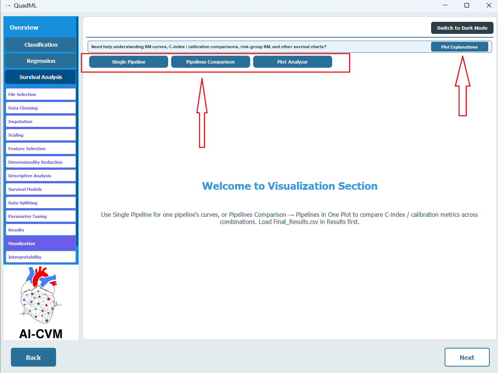
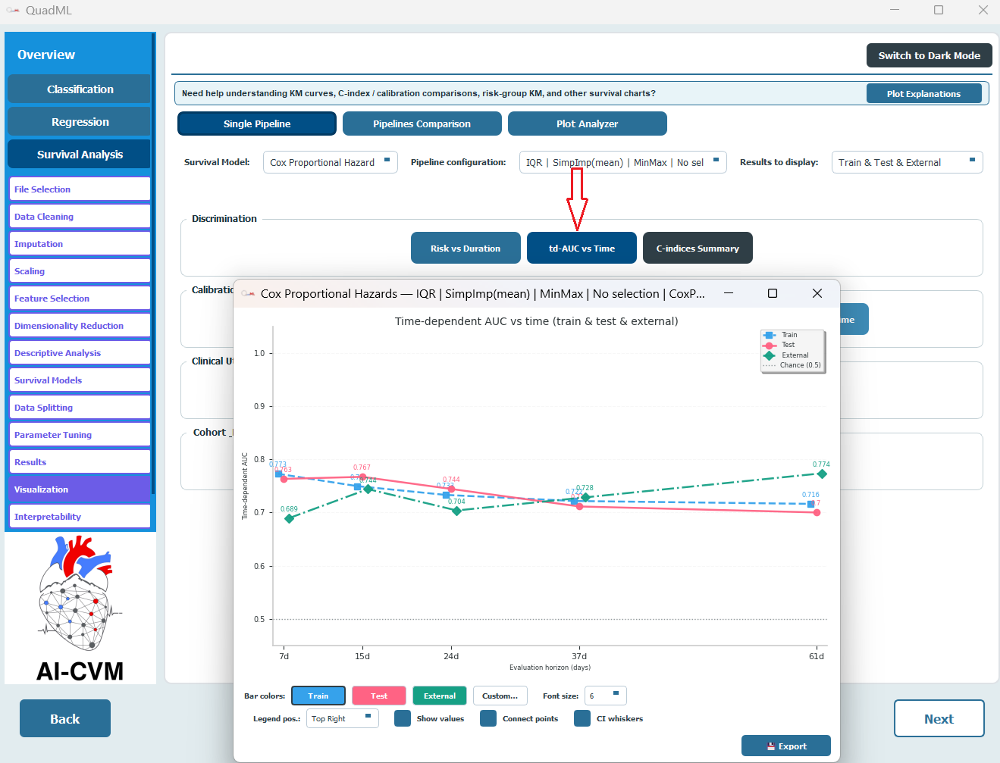
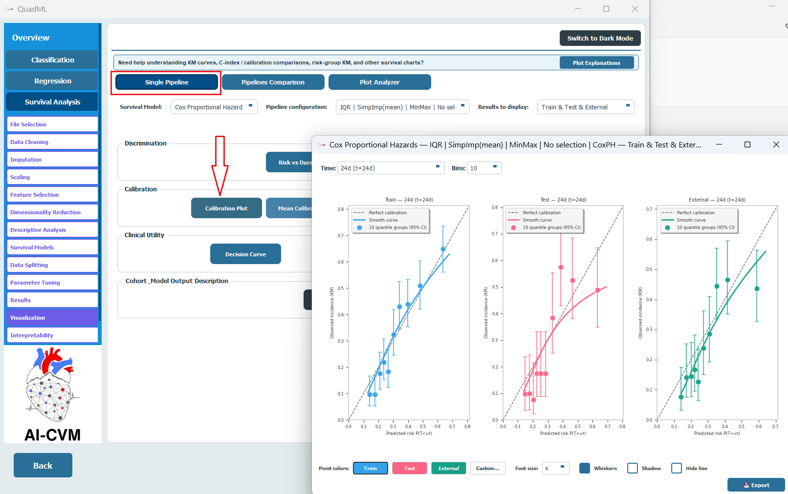
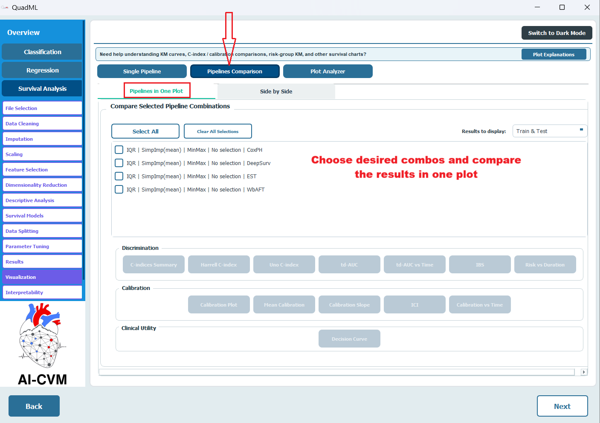
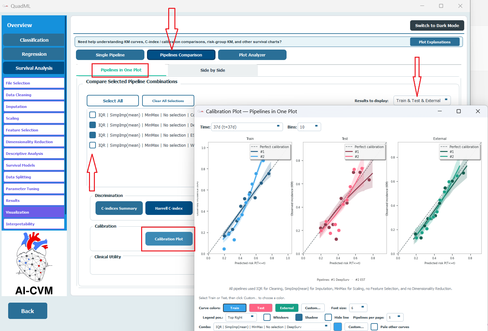
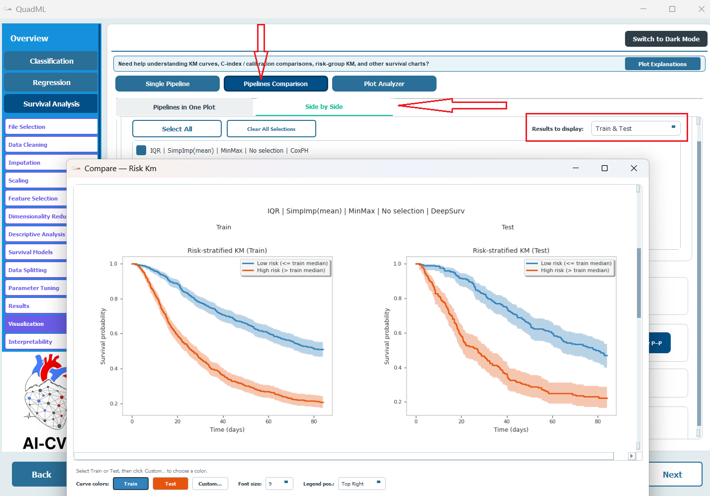

# Survival Analysis — Visualization

Shows survival charts for the pipelines you already scored on **Results** descriptive cohort curves, discrimination, risk grouping, and calibration. Load `Final_Results.csv` in **Results** first, then open **Visualization** and choose **Single Pipeline** (one configuration’s curves), **Pipelines Comparison** (C-index / calibration bars across combinations), or **Plot Analyzer**. Prefer **Test** or **External** when judging generalization. You can plot Kaplan–Meier / Nelson–Aalen curves, risk-group KM, risk scores, td-AUC vs time, calibration plots, and related figures; availability depends on the selected model (for example AFT QQ plots for AFT models; some charts are hidden for SSVM). Use **Plot Explanations** and **Analyze** for in-app help.

--8<-- "_snippets/visualization-usage.md"

Choose **Single Pipeline**, **Pipelines Comparison**, or **Plot Analyzer**:

**Single Pipeline** pick a pipeline and set **Results to display** (prefer **Test** or **External**):

## Descriptive models

| Plot | What it shows |
|------|----------------|
| Kaplan-Meier | Cohort survival \(S(t)\) |
| Median Survival | Median survival when defined |
| Nelson-Aalen | Cumulative hazard \(H(t)\) |

Kaplan–Meier for Train / Test / External:

Nelson–Aalen cumulative hazard:

## Discrimination / risk

| Plot | What it shows |
|------|----------------|
| Risk Group KM | Median Train risk cut applied to Test/External |
| Risk Score Distribution | Predicted risk scores |
| Risk vs Duration | Risk against follow-up time |
| td-AUC vs Time | Discrimination across horizons |
| C-index / metric bars | Compare pipelines |

Cox Single Pipeline plot groups (Discrimination, Calibration, Clinical Utility, Risk Stratification):

td-AUC vs Time:

## Calibration / utility

| Plot | What it shows |
|------|----------------|
| Calibration Plot | Predicted vs observed risk |
| Mean Cal / Slope / ICI bars | Across pipelines |
| Calibration vs Time | Calibration over horizons |
| Decision Curve | Net benefit at a horizon (hidden for SSVM) |

Calibration Plot for Train / Test / External:

## Comparing pipelines

**Pipelines Comparison** → **Pipelines in One Plot** — select combinations, then open a metric chart:

Integrated Brier Score across pipelines:

Calibration Plot across selected pipelines:

**Side by Side** Risk Group KM:

## Other

| Plot | What it shows |
|------|----------------|
| Censoring Timeline | Follow-up / censor pattern |
| AFT QQ / P–P | AFT fit checks (AFT only) |

Use **Plot Explanations** / **Analyze** for in-app help. KM / Nelson–Aalen often need **Single Pipeline** views.

## Common mistakes

- Opening Visualization before any successful combination finished
- Mixing plots from an older dated folder after starting a new run
- Reading Train-only plots as trustworthy absolute performance
