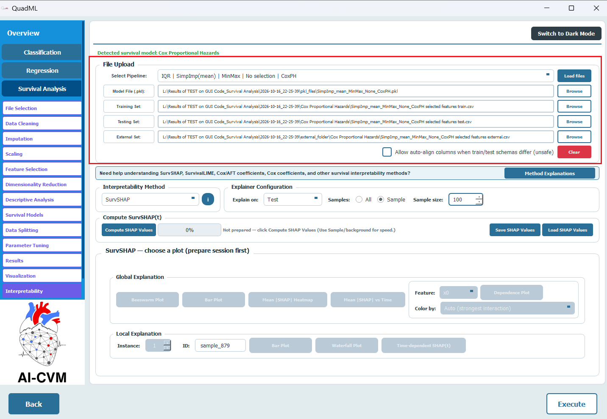
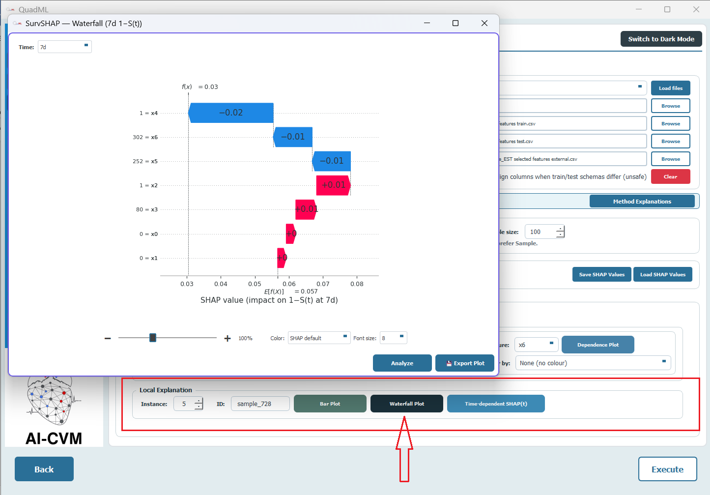
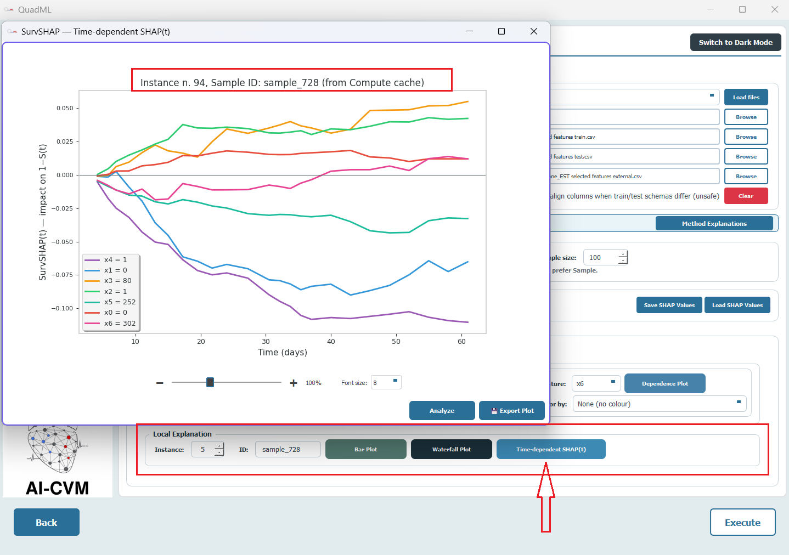
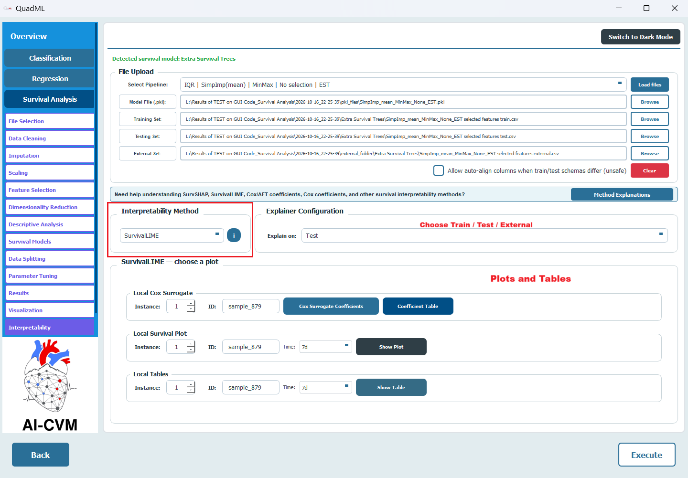
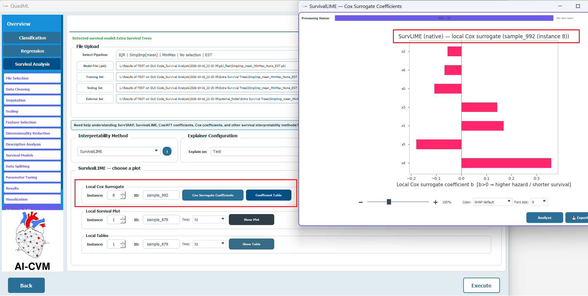
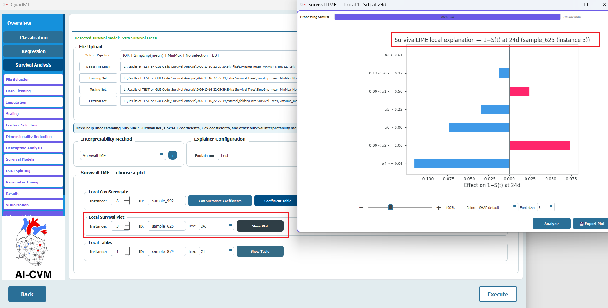
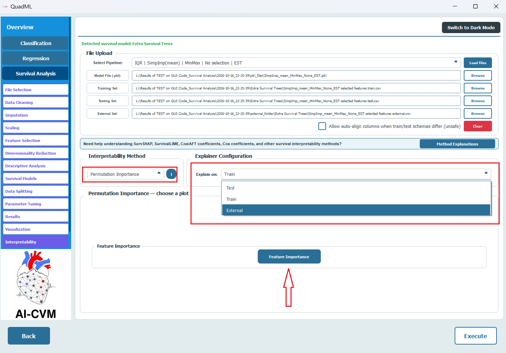
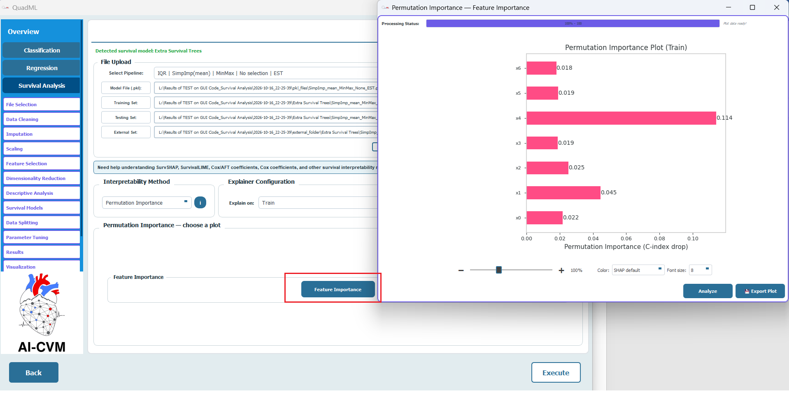
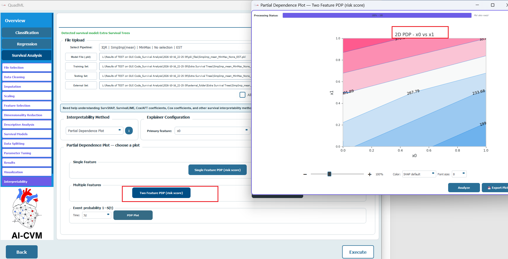

# Survival Analysis — Interpretability

**Where**: Survival Analysis → **Interpretability**

**Interpretability** explains **why** a fitted **covariate** survival pipeline predicts risk: you load one completed model (`.pkl` plus its feature CSVs with duration and event), prepare an explainer (SurvSHAP, SurvivalLIME, Permutation, PDP/ICE, Cox/AFT coefficients), and open local or global plots. Use it after Results to understand a chosen pipeline — it does **not** replace Test or External metrics for ranking performance.

Point Results (and then Interpretability) at the same dated run folder under your **Output Directory** — typically `Output Directory / YYYY-MM-DD_HH-MM-SS / Final_Results.csv`. That CSV lists the finished combinations; the matching `.pkl` and feature CSVs for a row live in that same run folder (or its subfolders). You can also Browse an older run’s `Final_Results.csv` if you want to explain a previous search.

**Kaplan–Meier** and **Nelson–Aalen** have **no** interpretability methods (descriptive only). Use **Visualization** for their curves.

Explanations target predicted risk and/or horizon event probability \(1−S(t \mid x)\). Positive local attributions mean **higher event risk** (worse prognosis).

---

## Recommended workflow

1. **Results** — load `Final_Results.csv` from the dated run folder (`Output Directory / <run timestamp>/`).
2. **Interpretability** — Select Pipeline → **Load files** (model `.pkl`, training features CSV, testing features CSV) from that same run. CSVs must include duration and event.
3. Choose a method compatible with the detected model.
4. Click **Prepare Explainer** / **Compute** as shown — plot buttons stay disabled until this finishes.
5. If the page shows **Explainer Configuration** for that method, set those options before or after prepare as the UI allows.
6. Open plots from the grouped plot buttons.
7. Use the Browse fields only if you need to override the auto-filled `.pkl` or feature-CSV paths.

Most methods do **not** retrain the pipeline; they explain the loaded `.pkl`.

---

## Methods

### SurvSHAP(t)

**SurvSHAP(t)** is the main survival-aware SHAP method in QuadML (via the `survshap` package). It attributes each feature’s contribution to the predicted **event probability** \(1−S(t)\) across the evaluation-time grid, so you can see how importance changes over follow-up — not only at a single cut. Positive values mean that feature pushed **higher event risk** (worse prognosis) for that patient at that time; negative values mean the opposite.

**Attention:** SurvSHAP can take a **long time** to compute (especially on RSF / Extra Survival Trees, wide feature sets, or **All** patients). Prefer **Sample of N** for a first look. After a successful run, **save the calculated values** so you do not have to recompute them later.

- **Patients:** **All** vs **Sample of N** (faster first look)
- **Save SHAP Values** — writes `{combo}_SurvSHAP_{split}.npz` (metadata inside the file) so you can reuse the attributions later
- **Load SHAP Values** — reloads a previously saved `.npz` for the **same** pipeline combination and Explain-on split, then opens plots without recalculating
- Auto-cache also lands under `{results_folder}/Interpretability/SurvSHAP/`
- Plots: Summary / Waterfall per horizon, Integrated summary, Dependence, Mean |SHAP| heatmap / vs time, local time-dependent lines

Not available for **SSVM** (no \(S(t)\)). A `.npz` from a different combo or split is rejected — load files that match the current pipeline.

### SurvivalLIME

- **Native:** SurvLIME-style Cox surrogate over the cumulative hazard curve
- **LIME approximation:** ordinary LIME on \(1−S(t)\) at one evaluation horizon

Plots: Cox surrogate coefficients / tables; local survival views at a chosen Time.

### Permutation Importance

**Permutation Importance** ranks features **globally** by how much concordance (C-index) falls when that feature’s values are randomly shuffled. A large drop means the feature mattered for ranking on the chosen split. Use it for an overall “which columns drive discrimination?” view, not for explaining one sample like SurvivalLIME.

### PDP Plot

**PDP** shows average (or related) effects on risk score or \(1−S(t)\) at a chosen evaluation day (**Time** combo), while averaging over the other columns.

### ICE

**ICE** draws one curve **per sample** as a single feature varies, so you can see how predictions change for individual rows rather than only the PDP average. Heterogeneous curves mean the feature effect differs across samples.

---

## Model availability (summary)

| Model family | Typical methods |
|--------------|-----------------|
| Cox PH | SurvivalLIME, Permutation, PDP, ICE, SurvSHAP, Cox Coefficients |
| AFT | Same globals + AFT Acceleration Factors |
| RSF / EST / SGBM / DeepSurv | SurvivalLIME, Permutation, PDP, ICE, SurvSHAP |
| SSVM | SurvivalLIME, Permutation, PDP, ICE (no SurvSHAP) |
| KM / Nelson-Aalen | None |

Risk-score histograms, Risk vs Duration, and Risk Group KM are in **Visualization**, not Interpretability. Ordinary classification-style SHAP / Kernel SHAP / LIME on hard labels is **not** the Survival Interpretability path — use SurvSHAP and SurvivalLIME.

---

## Display vs model space

When scaling is on, PDP / ICE / SurvSHAP dependence axes can show original (pre-scale) feature values while the model still uses scaled inputs. After DR (PCA / ICA / Kernel PCA), explanations use the compressed component space as applicable.

---

## What is written to disk

Explainer caches and optional SurvSHAP `.npz` archives live under the current dated **run folder** (and its Interpretability subfolders) for that session, so you can reopen plots without rebuilding everything from scratch when paths stay valid.

For the full in-app wording of each method, use the explanations bar or the **i** buttons on the Interpretability page.

---

## Common mistakes

- Loading CSVs without duration/event
- Loading features from a different combination than the `.pkl`
- Loading a SurvSHAP `.npz` from a different combo or Explain-on split (rejected)
- Expecting Interpretability for KM / Nelson–Aalen
- Treating Train explanations as external validation
- Looking for Risk Group KM here — that plot is on **Visualization**
