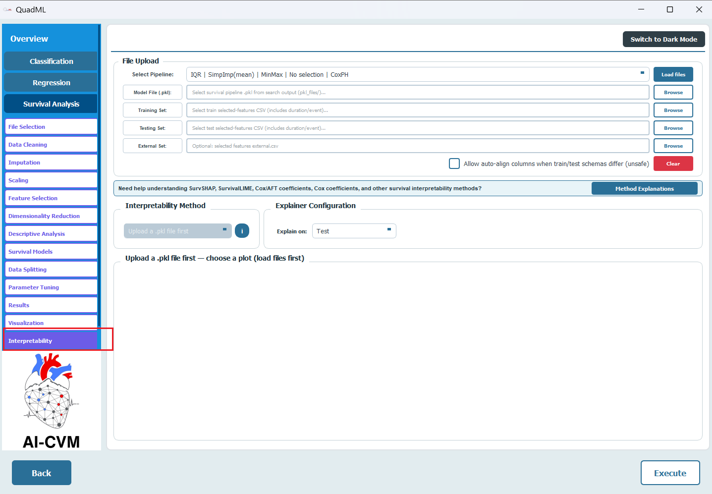

# Survival Analysis — Interpretability

**Where**: Survival Analysis → **Interpretability**

Explains a loaded **covariate** survival pipeline. Does **not** replace Test metrics. Kaplan–Meier and Nelson–Aalen have **no** interpretability — use Visualization.

--8<-- "_snippets/interpretability-usage.md"

**Task notes:** Feature CSVs must include duration and event. Positive attributions mean **higher event risk** (worse prognosis). Prefer SurvSHAP / SurvivalLIME; save SurvSHAP `.npz` values after slow runs.

## Methods

| Approach | What it shows | Scope |
|----------|---------------|--------|
| **SurvSHAP(t)** | Feature push on \(1−S(t)\) across time | All rows and single rows |
| **SurvivalLIME** | Local Cox / LIME-style explanation | Single rows |
| **Permutation Importance** | Drop in C-index when a feature is shuffled | All rows |
| **PDP** | Average risk / \(1−S(t)\) as a feature varies | All rows |
| **ICE** | One curve per row as a feature varies | Single rows |
| **Cox / AFT coefficients** | Model coefficients or acceleration factors | Global (Cox / AFT) |

| Model family | Typical methods |
|--------------|-----------------|
| Cox PH / AFT | SurvSHAP, SurvivalLIME, Permutation, PDP, ICE, coefficients |
| RSF / EST / SGBM / DeepSurv | SurvSHAP, SurvivalLIME, Permutation, PDP, ICE |
| SSVM | SurvivalLIME, Permutation, PDP, ICE (no SurvSHAP) |
| KM / Nelson-Aalen | None |

## Common mistakes

- Loading CSVs without duration/event  
- Expecting Interpretability for KM / Nelson–Aalen  
- Treating Train explanations as validation  
- Running Interpretability without a successful fitted `.pkl`
