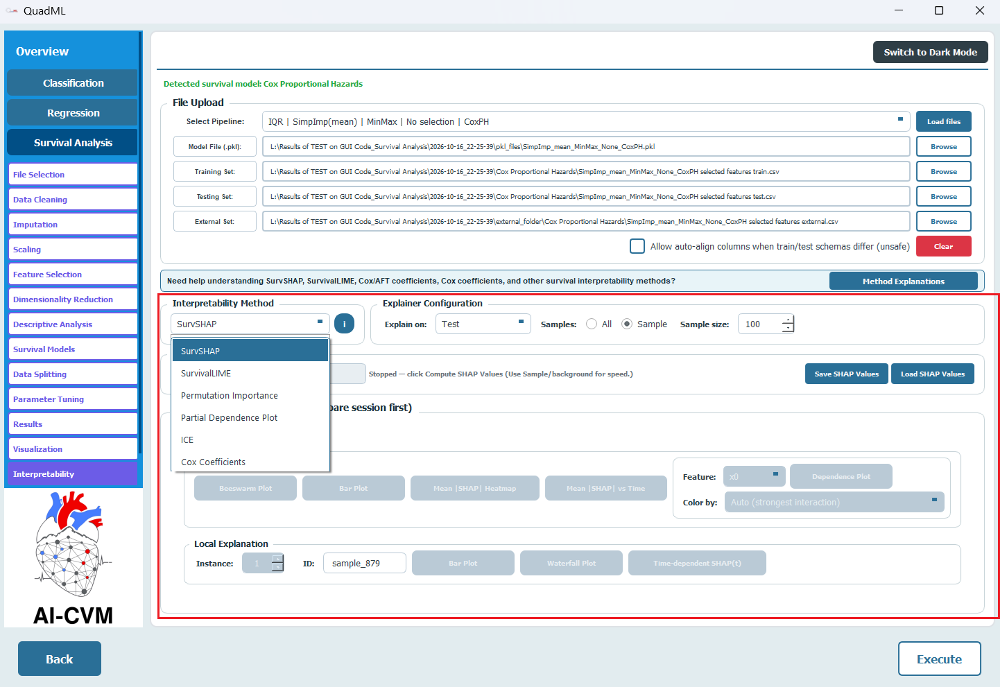
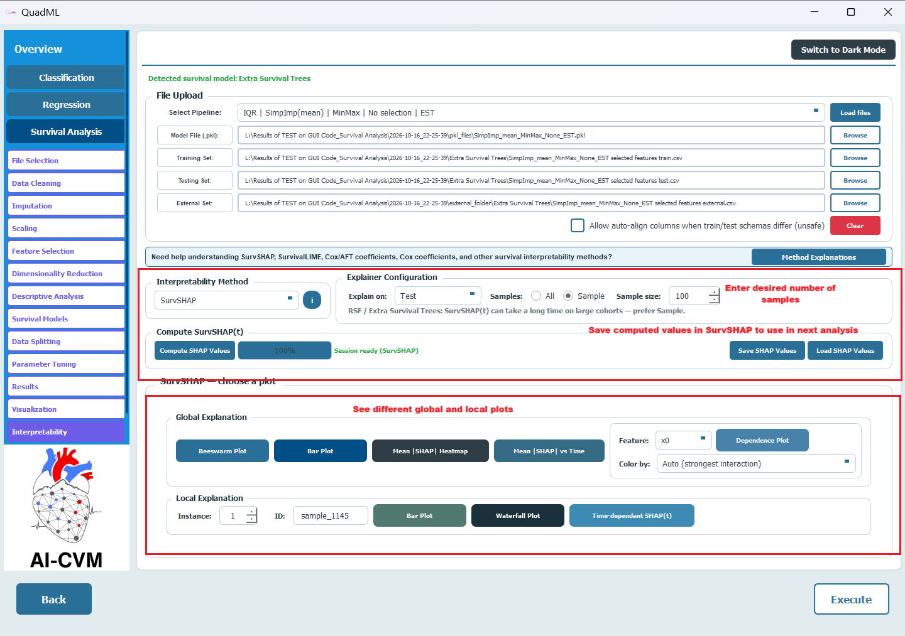
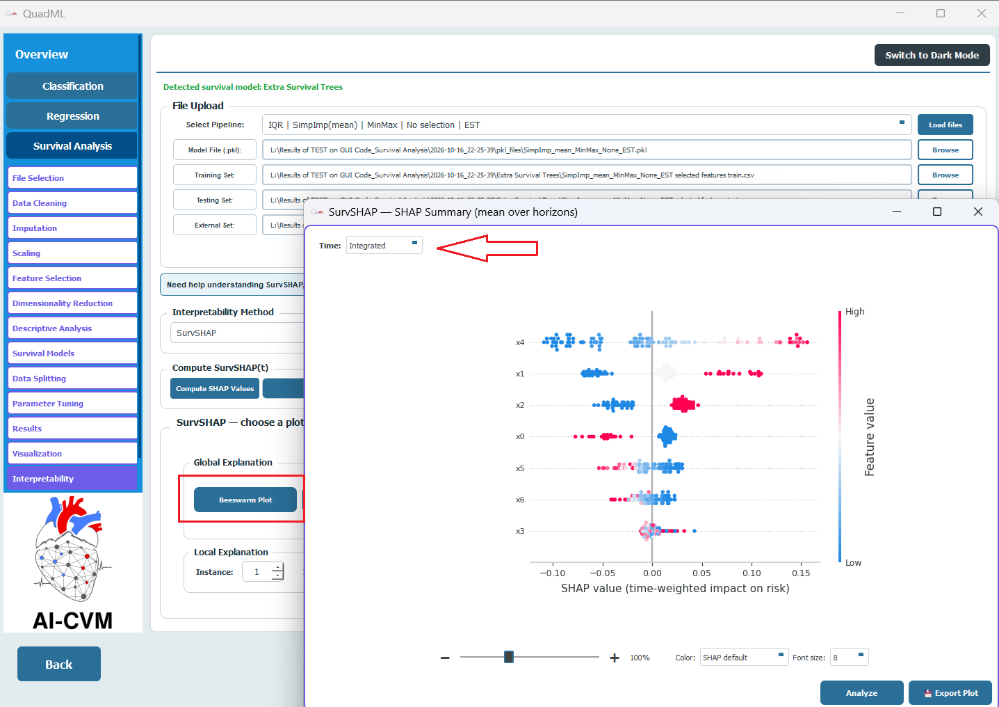
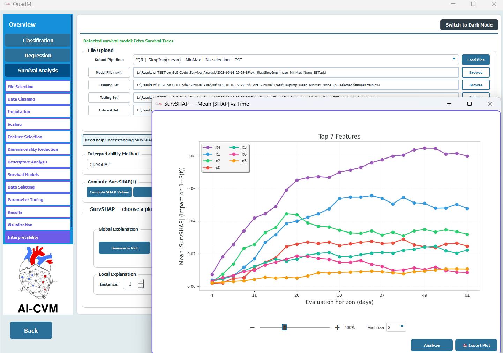
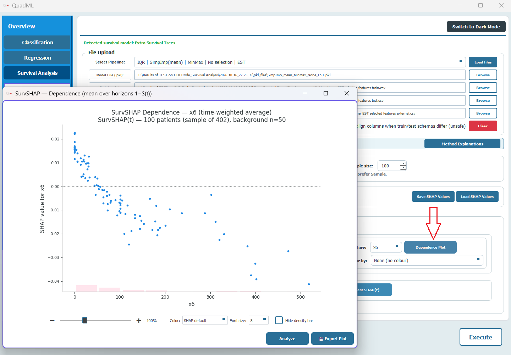
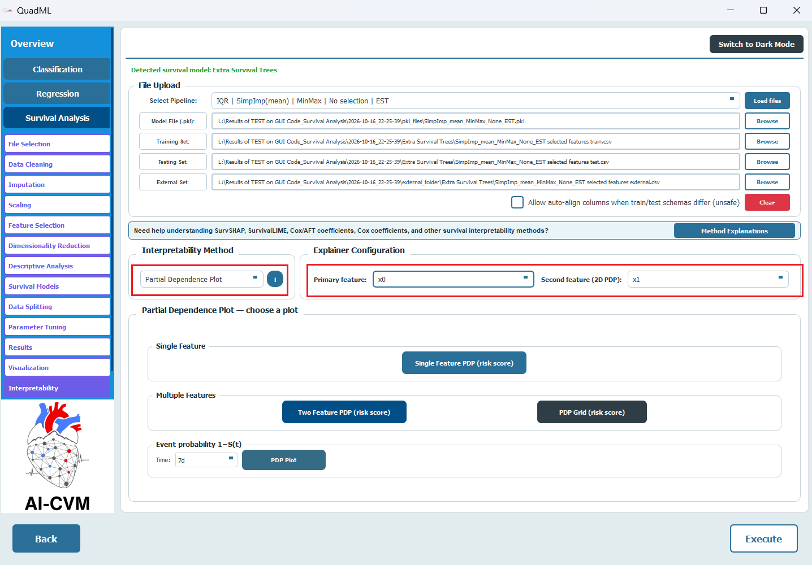
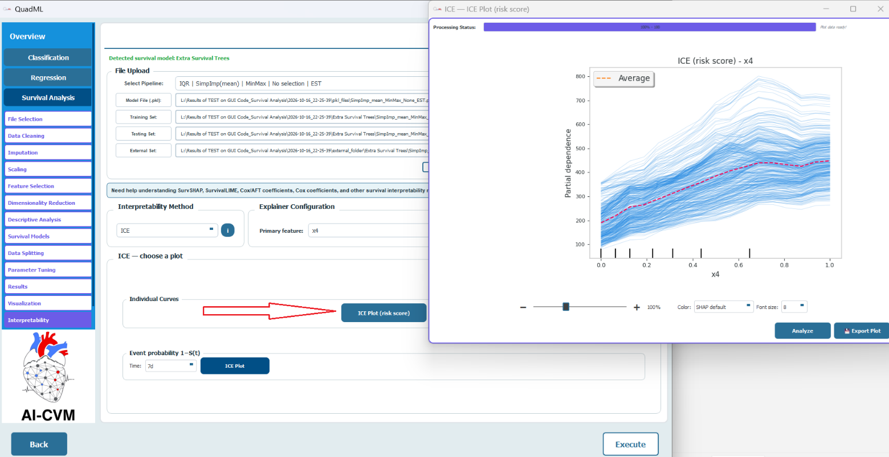
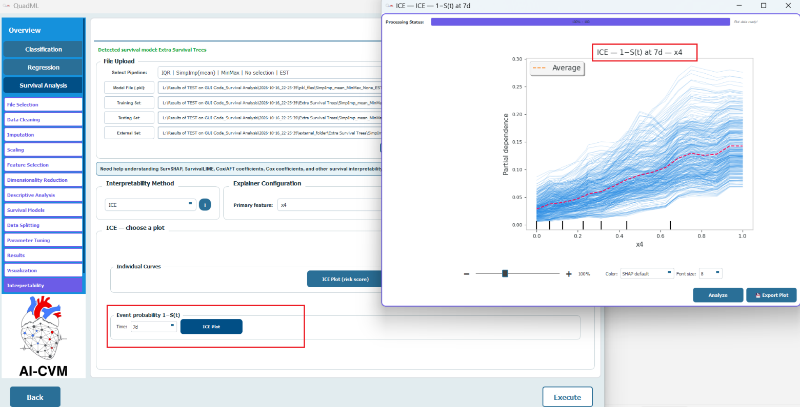

# Survival Analysis — Interpretability

Shows which features drive predicted event risk or survival for a loaded **covariate** survival pipeline (global and local explanations). Use it after you choose a candidate from **Results**. It does **not** replace Test or External metrics for ranking models. Load the matching `.pkl` and feature CSVs (they must include **duration** and **event**), choose a method compatible with the model, set **Explain on**, then **Prepare Explainer**. Prefer **SurvSHAP(t)** and **SurvivalLIME** when available; Cox / AFT also expose coefficients; SSVM has no SurvSHAP. Positive attributions mean **higher event risk** (worse prognosis). SurvSHAP can be slow, save `.npz` values after long runs to use in the future tries. Kaplan–Meier and Nelson–Aalen have **no** Interpretability. Use **Visualization** for those curves.

--8<-- "_snippets/interpretability-usage.md"

Load the matching `.pkl` and feature CSVs for one pipeline, choose a method and **Explain on** split, then compute / prepare the explainer:

Available methods for a covariate model (for example Cox):

SurvSHAP session ready — sample size, Save / Load SHAP values, global and local plot buttons:

## Methods

| Approach | What it shows | Scope |
|----------|---------------|--------|
| **SurvSHAP(t)** | Feature push on \(1−S(t)\) across time | All rows and single rows |
| **SurvivalLIME** | Local Cox / LIME-style explanation | Single rows |
| **Permutation Importance** | Drop in C-index when a feature is shuffled | All rows |
| **PDP** | Average risk / \(1−S(t)\) as a feature varies | All rows |
| **ICE** | One curve per row as a feature varies | Single rows |
| **Cox / AFT coefficients** | Model coefficients or acceleration factors | Global (Cox / AFT) |

| Model family | Typical methods |
|--------------|-----------------|
| Cox PH / AFT | SurvSHAP, SurvivalLIME, Permutation, PDP, ICE, coefficients |
| RSF / EST / SGBM / DeepSurv | SurvSHAP, SurvivalLIME, Permutation, PDP, ICE |
| SSVM | SurvivalLIME, Permutation, PDP, ICE (no SurvSHAP) |
| KM / Nelson-Aalen | None |

SurvSHAP beeswarm (mean over horizons):

SurvSHAP Mean |SHAP| vs Time:

SurvSHAP dependence plot:

SurvSHAP waterfall for one instance:

SurvSHAP(t) time-dependent local curves:

SurvivalLIME method and local plot controls:

SurvivalLIME Cox surrogate coefficients:

SurvivalLIME local explanation at a horizon:

Permutation Importance — choose **Explain on** and Feature Importance:

Permutation Importance plot (C-index drop):

Partial Dependence Plot controls (primary / second feature):

Two-feature PDP (risk score):

ICE plot (risk score):

ICE for event probability \(1−S(t)\) at a horizon:

## Common mistakes

- Loading CSVs without duration/event  
- Expecting Interpretability for KM / Nelson–Aalen  
- Treating Train explanations as validation  
- Running Interpretability without a successful fitted `.pkl`
