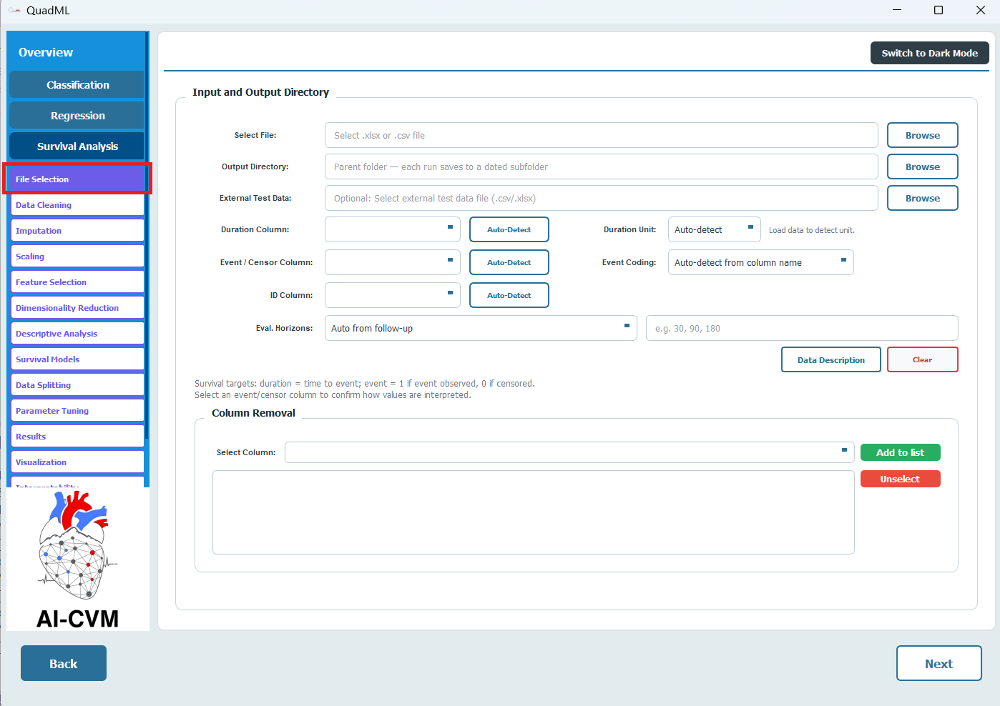

# Survival Analysis — Tutorial

End-to-end click path for a first Survival run. Keep the search small.

---

## 1. Start

1. Open QuadML → **Survival Analysis** → **File Selection**.
2. **Select File → Browse** — `.csv` / `.xlsx` with duration, event, and features.
3. **Output Directory → Browse** — writable parent folder.
4. Set **Duration Column** and **Event / Censor Column** (or **Auto-Detect**).
5. Set **Event Coding** so **1 = event observed** unless your file differs.
6. Leave **Eval. Horizons** on **Auto from follow-up**.
7. Optional: ID Column, Column Removal, External file (must include duration + event).

---

## 2. Preprocess

| Step | Choice |
|------|--------|
| Data Cleaning | **None** |
| Imputation | **Simple Imputation** |
| Scaling | **Standard Scaler** |
| Feature Selection | **None** |
| Dimensionality Reduction | **None** |

---

## 3. Models and split

1. **Descriptive Analysis:** **Kaplan-Meier**.
2. **Survival Models:** **Cox Proportional Hazards** only.
3. **Data Splitting:** 80/20, Train on all data **off**.

---

## 4. Run

1. **Parameter Tuning:** Random Search, **Fast**, CPU/RAM 50/50.
2. Review the tree → **Start Procedure** → wait (or **Stop** to cancel).

---

## 5. Read output

1. **Metrics:** prefer **Test** calibration (Mean Cal / Slope / ICI), then C-index / td-AUC.
2. **Visualization:** KM curve; Risk Group KM / Calibration for Cox.
3. **Interpretability:** Load the Cox pipeline; try coefficients or SurvSHAP.

Success: `Final_Results.csv` under `Your Folder\YYYY-MM-DD_HH-MM-SS\`.
